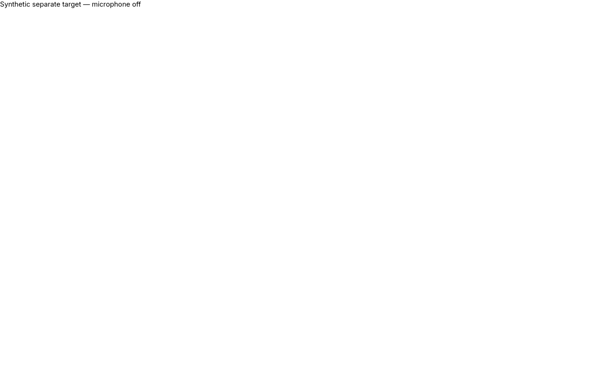
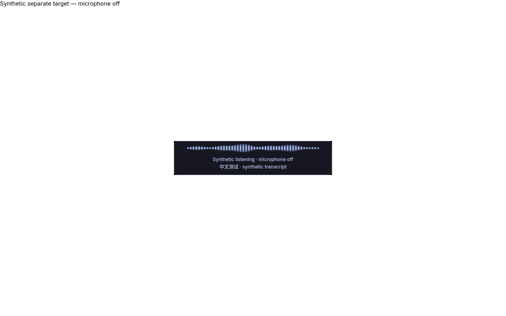

# X11 recording overlay: before/after evidence

Application commit: [f8db0ddf57e287f862376449ef57fc049e2f13cc](https://github.com/laukkw/doubao-say/commit/f8db0ddf57e287f862376449ef57fc049e2f13cc).
Baseline: upstream d4be00554b375abd14aa882903dee6379c2f7923.

These captures show the actual Overlay class over an independent fullscreen GTK
editor in an isolated Xvfb/XFWM desktop on Arch Linux. Text and RMS values are
synthetic. No microphone, network, clipboard or keyboard injection was used.
No private transcript, login data or real desktop content is present.

| Before | After |
| --- | --- |
|  |  |

The before case confirms that the overlay is mapped but stacked below the target.
The after case confirms ABOVE and a higher frame stacking position while both
active-window and raw keyboard-focus remain on the target. Structured observations
are in state-summary.json. Inspecting focus every 20 ms cannot rule out a shorter
transient.

The same harness passes repeated show/hide cycles, all four waveform styles with
reduced motion on/off, synthetic polishing/transcribing, another workspace, an
ordinary target, missing/hung helpers, immediate hiding and destruction. Helper
and disposable desktop processes exited. Fullscreen behavior is WM-dependent.

## Reproduce

Install the optional manual-test prerequisites listed in
`tests/manual/overlay_stacking.py`, then run from the application branch:

```sh
git worktree add --detach /tmp/doubao-overlay-before d4be00554b375abd14aa882903dee6379c2f7923
PYTHONPATH=/tmp/doubao-overlay-before/src timeout --kill-after=5s 40s python3 tests/manual/overlay_stacking.py --run --expect-hidden --artifacts /tmp/overlay-before
PYTHONPATH=src timeout --kill-after=5s 40s python3 tests/manual/overlay_stacking.py --run --artifacts /tmp/overlay-after
```

Before/after probe, make check, make coverage, dependency checks and secret scan
passed against the exact application tree. 391 Python tests and 38 Node tests
passed; branch coverage was 62%. The user also reported the installed overlay
appeared visible over fullscreen Ghostty on XFCE/X11. This visual feedback does
not establish complete ASR or text-delivery acceptance.

Live Wayland/XWayland, another X11 WM, multiple monitors, Flatpak host-process
cleanup, Midscene desktop E2E and a release build were not exercised this round.
This evidence-only branch is separate from the code PR and release payloads.
